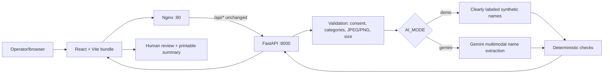

# Dishari (দিশারী)

**An AI-assisted, human-reviewed document-checking demo for last-mile service centres.** Dishari helps an operator collect a citizen's consent, review three categories of documents, highlight possible name mismatches, and produce a multilingual summary. **It does not verify identity, decide official eligibility, submit government applications, or approve loans.**

> **Demo safety:** This is a hackathon/MVP build, not a production citizen-data service. Use **synthetic test documents only**. The demo is not approved for collecting or retaining actual Aadhaar, bank, or land-record data.

## At a glance

| Area | Implementation |
| --- | --- |
| Frontend | React 18, TypeScript, Vite 6, CSS, Lucide icons, Zod contracts |
| Languages | English, Hindi, Bengali; switch without repeating the check |
| Web server | Nginx serves the compiled frontend and proxies `/api/` |
| Backend | Python 3.12, FastAPI, Uvicorn |
| AI | `AI_MODE=demo` synthetic extraction, or `AI_MODE=gemini` real multimodal name extraction |
| Rules | Deterministic Python comparison and **provisional/unknown** scheme checks |
| Persistence | None: no database, queues, user accounts, or stored case history |
| Deployment | Two Docker containers on one Compose network |

## Three-screen operator flow

1. **Upload** — consent first; applicant type, crop/activity, requested loan amount; select each of **Aadhaar**, **bank passbook**, and **Khatian** exactly once; upload 1–4 JPG/PNG files for *each* category (maximum 5 MiB per file).
2. **Review** — a visible **sample/live** source indicator, extracted name comparisons, potential outlier, explanation, and KCC/PM-JAY checks. The operator must deliberately approve before moving on.
3. **Citizen summary** — local-language, print-friendly, non-official summary with a one-click print option. Approval advances the UI; it **does not** file any government application.

There is also a **Try a sample case** button. It loads a fictional fixture in the browser **without** any backend or network request (consent still required). The separately configured `AI_MODE=demo` backend accepts synthetic uploads and returns a synthetic result; it does **not** analyze the image content.

### Interface previews

These are design previews of the three pages, **not screenshots confirming the live EC2 deployment**.

| Upload | Review | Citizen summary |
| --- | --- | --- |
|  |  |  |

## Architecture



- **Same-origin routing:** browsers call `/api/dishari/v1/documents` on the frontend host. Nginx forwards the **unchanged** path to `http://backend:8000` on the private Compose network. **The API route is lowercase** (`dishari`, not `Dishari`).
- **No API key in the browser:** Gemini credentials belong only in the backend environment; never use a `VITE_*` variable for a secret.
- **No automatic AI fallback:** if Gemini errors in `gemini` mode, the API returns an error rather than masquerading as live analysis.
- **Human-first:** extracted names and deterministic checks require manual verification. A provisional result is not official eligibility.

## Repository layout

```text
.
├── README.md                     # This guide
├── compose.yaml                  # Full-stack Docker Compose
├── .env.example                  # Backend AI mode and model settings
├── frontend/
│   ├── Dockerfile                # Node build -> Nginx runtime
│   ├── nginx.conf                # SPA fallback + /api proxy
│   ├── package.json / package-lock.json
│   ├── vite.config.ts            # Local /api proxy to FastAPI
│   └── src/
│       ├── App.tsx              # Three-step operator flow
│       ├── api/caseApi.ts       # Multipart request + response validation
│       ├── contracts/types.ts   # Zod contracts
│       ├── components/          # Stepper, slots, results, language, print
│       ├── data/demo.ts         # Offline fictional sample
│       ├── i18n/translations.ts # en/hi/bn copy
│       └── utils/validation.ts  # Client-side upload validation
├── backend/
│   ├── Dockerfile                # Python 3.12 + Uvicorn
│   ├── app.py                    # FastAPI routes and upload validation
│   ├── gemini.py                 # Synthetic or Gemini name extraction
│   ├── engine.py                 # Deterministic, provisional results
│   ├── requirements.txt
│   ├── demo_docs/               # Synthetic test images
│   └── tests/test_app.py
└── docs/screenshots/             # Representative three-page previews
```

## Quick start (Docker Compose)

**Requirements:** Docker Engine with a modern Compose plugin (and Buildx if required by your Docker installation). Make sure Docker can reach the npm registry; the frontend build installs dependencies.

```bash
# From repository root
cp .env.example .env
# Optional: change AI_MODE and Gemini key in .env

docker compose up -d --build
```

Open **http://localhost:8080**. Endpoints:

| Endpoint | What it does |
| --- | --- |
| `http://localhost:8080/` | React operator application |
| `http://localhost:8080/api/dishari/v1/health` | Health through Nginx → FastAPI |
| `http://localhost:8000/docs` | FastAPI Swagger UI bound to loopback on the Docker host |
| `POST http://localhost:8080/api/dishari/v1/documents` | Multipart document check |

Quick smoke test:

```bash
curl -fsS http://localhost:8080/api/dishari/v1/health
# Expect status: ok and configured ai_mode

docker compose ps
docker compose logs --tail=80 frontend backend
```

Stop containers without deleting files:

```bash
docker compose down
```

### EC2 deployment (Amazon Linux 2023)

1. Install/configure Docker, the **Compose plugin** and **Buildx** (Docker Compose's builder requires a recent enough Buildx). Verify with `docker compose version` and `docker buildx version`.
2. From the project root run `sudo docker compose up -d --build`.
3. Allow inbound **TCP 8080** in the EC2 security group **only from the intended audience**. Prefer a reverse proxy / HTTPS and restricted access for any public-facing demo.
4. Visit `http://EC2_PUBLIC_IP:8080`. The backend is not publicly published; Compose binds host port 8000 to `127.0.0.1` for diagnostics only.

If Buildx or npm registry connectivity breaks Compose builds, first repair the Docker plugins/network. As a **diagnostic workaround** on a trusted Linux host you can build manually:

```bash
sudo docker build --network=host --progress=plain -t dishari-backend:latest ./backend
sudo docker build --network=host --progress=plain -t dishari-frontend:latest ./frontend
sudo docker compose up -d --no-build
```

The Compose services carry explicit `image:` names to support this workaround. Host networking here affects the **build process**, not the runtime container topology.

### Local development (without Docker)

**Backend** — Python 3.12+:

```bash
cd backend
python3 -m venv .venv
source .venv/bin/activate
pip install -r requirements.txt
AI_MODE=demo uvicorn app:app --host 127.0.0.1 --port 8000 --reload
```

**Frontend** — Node 22 and npm, in a separate terminal:

```bash
cd frontend
cp .env.example .env
npm ci
npm run dev
```

Open **http://localhost:5173**. Vite proxies `/api/*` to `DISHARI_DEV_API_TARGET` (default `http://localhost:8000`).

## Configuration

**Root `.env`** (consumed by Compose; **do not commit**):

| Name | Default | Purpose |
| --- | --- | --- |
| `AI_MODE` | `demo` | `demo` synthetic fixture or `gemini` multimodal extraction |
| `GEMINI_API_KEY` | empty | Required when `AI_MODE=gemini`; backend-only secret |
| `GEMINI_MODEL` | `gemini-2.5-flash` | Gemini model selection; availability and access are account-dependent |

For real extraction with **synthetic test files only**:

```dotenv
AI_MODE=gemini
GEMINI_API_KEY=REPLACE_WITH_YOUR_KEY
GEMINI_MODEL=gemini-2.5-flash
```

Restart with `docker compose up -d --build` after changing configuration. The backend `/health` reports its selected AI mode; it does not verify whether your Gemini key is valid.

**Frontend `.env.example`** is for local Vite development:

| Name | Typical value | Purpose |
| --- | --- | --- |
| `VITE_PROD_SERVER` | `0` locally | Set to `1` at Docker build for production same-origin requests |
| `VITE_API_BASE_DEV_URL` | empty | Empty means relative `/api` requests in dev |
| `VITE_API_BASE_PROD_URL` | empty | Empty means relative `/api` requests in Nginx production |
| `DISHARI_DEV_API_TARGET` | `http://localhost:8000` | Vite dev proxy target (not exposed to browser) |

Use **relative URLs** in the production browser, not `http://backend:8000` (Docker-only DNS) or a hardcoded EC2 IP. `CORS_ORIGINS` is an optional backend setting for cross-origin local development; it isn't required for production same-origin requests via Nginx.

## API contract

**`POST /api/dishari/v1/documents`**; `multipart/form-data`:

| Field | Type / acceptable values |
| --- | --- |
| `consent` | `true` (required) |
| `applicant_type` | `owner`, `tenant`, `joint`, `other` |
| `crop_or_activity` | Nonempty text, max 200 characters |
| `requested_loan_amount` | Positive integer up to 999999999 |
| `preferred_language` | `en`, `hi`, `bn` |
| `aadhaar` | 1–4 repeated JPG/PNG file parts |
| `bank_passbook` | 1–4 repeated JPG/PNG file parts |
| `khatian` | 1–4 repeated JPG/PNG file parts |

All **three categories** are required, with max **12 images total** and **5 MiB per image**. The server checks file signatures as well as declared MIME types. PDF is **not supported** by the current backend. It returns errors for missing consent, invalid input, oversized files, unsupported media, or provider failures.

Example using synthetic fixtures from `backend/demo_docs`:

```bash
curl -sS -X POST http://localhost:8080/api/dishari/v1/documents \
  -F 'consent=true' \
  -F 'applicant_type=owner' \
  -F 'crop_or_activity=Boro paddy' \
  -F 'requested_loan_amount=40000' \
  -F 'preferred_language=en' \
  -F 'aadhaar=@backend/demo_docs/aadhaar_front.jpg;type=image/jpeg' \
  -F 'bank_passbook=@backend/demo_docs/passbook.jpg;type=image/jpeg' \
  -F 'khatian=@backend/demo_docs/khatian.png;type=image/png'
```

Response (`200`): JSON includes `schemaVersion`, `caseId`, `analysisOrigin` (`sample`/`live`), `reviewRequired`, `applicantName`, `extracted`, `mismatches`, `ruleChecks`, `schemes`, and multilingual `citizenSummary` (`en`, `hi`, `bn`). The frontend validates this contract with Zod before displaying results.

**Processing sequence:** consent → file/type/size validation → demo fixture or Gemini name extraction → normalized name comparison by distinct document category → deterministic KCC/PM-JAY *cannot-determine* checks → review UI → deliberate human approval → print. Note: `KCC` and `PM-JAY` are demonstrative, **not authoritative policy engines**.

## Testing

```bash
# Backend: install test runner separately if necessary
cd backend
python3 -m pip install pytest
python3 -m pytest -q tests/test_app.py

# Frontend
cd ../frontend
npm ci
npm test
npm run build
```

Useful diagnostics:

```bash
# Is the backend running inside Compose?
docker compose ps
docker compose logs --tail=100 backend

# Is the full-stack reverse proxy healthy?
curl -i http://localhost:8080/api/dishari/v1/health

# Frontend build log
docker compose build --progress=plain frontend
```

## Troubleshooting

### `npm error Exit handler never called!` during Docker build

This typically appears during `npm ci`; **the error message alone doesn't prove the cause**. Check npm logs, registry access, DNS, free memory, and available disk space. The bundled frontend Dockerfile uses `node:22-bookworm-slim` rather than `node:22-alpine` for build compatibility, and a low npm socket count.

```bash
free -h
df -h
curl -I https://registry.npmjs.org/
sudo docker build --no-cache --network=host --progress=plain -t dishari-frontend:latest ./frontend
```

`--network=host` is useful **only if the host's network works and Docker's build network is the problem**. It is not a universal npm fix. Keep `package-lock.json`; prefer `npm ci` over bypassing reproducibility with an unexamined `npm install` fallback.

### `compose build requires buildx 0.17.0 or later` / plugin permission denied

Install or upgrade the **official Docker Buildx CLI plugin** for your CPU architecture, ensure the plugin executable has permission, and verify:

```bash
sudo docker buildx version
sudo docker compose version
sudo docker info
```

### `502 Bad Gateway` or API network error

Check `docker compose ps`, `docker compose logs backend`, and the shared Compose network. Nginx must resolve `backend` and proxy to port `8000`. Verify the full lowercase route `/api/dishari/v1/documents`. Backend health: `/api/dishari/v1/health`.

### Browser loads but uploads fail

Confirm consent, all required form fields, **each of the three unique document types**, at least one valid image per type, and proper size. In JavaScript, send `FormData` **without manually setting `Content-Type`**, so the browser sets the multipart boundary.

### Gemini errors

Set `AI_MODE=gemini`, configure `GEMINI_API_KEY` only on the backend, ensure outbound HTTPS access, and examine backend logs. Errors are intentionally displayed, not silently replaced with sample results.

## Boundaries and next steps

- For the MVP, no database or storage: case results are ephemeral. **No login/authentication, secure record retention, official beneficiary-list lookup, government integration, or auditable consent**.
- Gemini extracts **names only**, not a complete verification of records; mismatch detection is heuristic and may be wrong.
- KCC and PM-JAY currently require manual verification. Source URLs embedded in the rule module are reference links, **not proof of official eligibility**.
- English/Hindi/Bengali phrasing needs review by qualified native speakers before citizen-facing use.
- For real-world deployment, add access control, TLS, privacy/legal review, explicit retention controls, abuse protection, comprehensive auditing, and independently reviewed rules. **Do not upload actual citizen PII to this MVP.**

---

**Project status:** Demonstration implementation. Production validation, live Gemini service availability, government-rule correctness, and deployment readiness have **not** been independently verified here.
