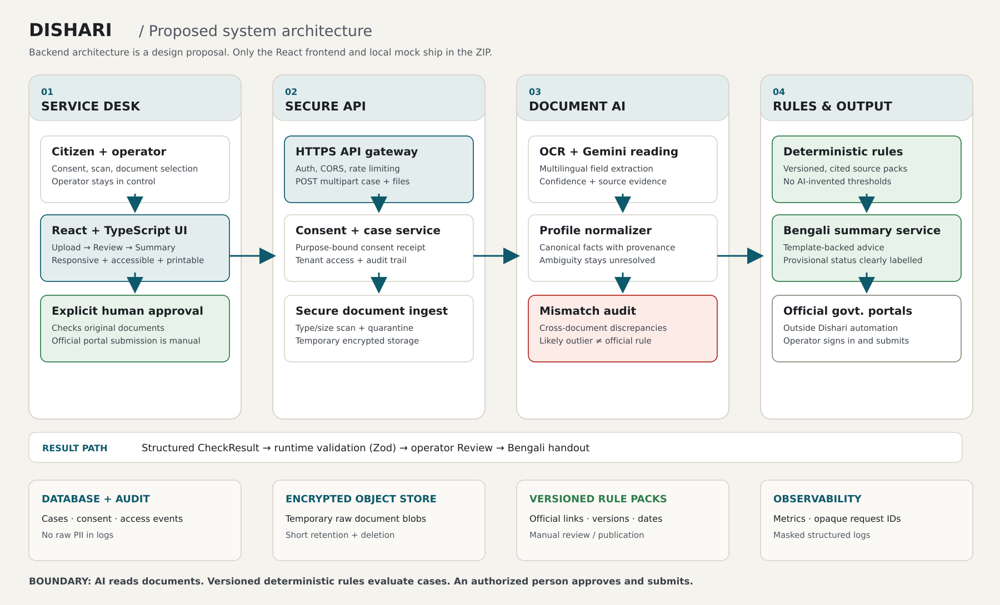

# Dishari — Operator frontend

**React 18 + TypeScript + Vite**, built around the three-stage service-centre workflow in `dishari-frontend-spec.md` and the Dishari buildathon brief. The interface is responsive, print-friendly, keyboard-accessible, and deliberately operator-controlled.

> **Scope:** This ZIP contains a functional **frontend** and a **synthetic mock API**, not a deployed eligibility engine. The offline sample is intentionally fictional/unverified. Do not use sample results for real citizens, benefits decisions, or public demonstrations without clear sample labelling.

## Get running

Requirements: Node.js **20.19+**, npm (or a compatible package manager).

```bash
npm install
cp .env.example .env
npm run dev
```

Open **http://localhost:5173**. Tick **Applicant consent**, then select **Use demo case** to walk through the complete three-step flow **without an API**. Check results, approve, preview the Bengali handout, and print. You can navigate back or start a new case.

### Try the HTTP integration boundary

Terminal 1:

```bash
npm run mock:api
```

Terminal 2: set `VITE_DISHARI_API_BASE_URL=http://localhost:8787` in `.env`, then:

```bash
npm run dev
```

Tick consent, upload any **synthetic** PDF or image, and click **Check case**. The local mock ignores the document and returns the same explicitly labelled **sample** result. Do not use personal documents with the mock. Disconnect by clearing the environment variable and restarting Vite.

### Quality checks

```bash
npm run typecheck
npm run lint
npm test
npm run build
npm run preview
```

## What works now

- Three screens: **Upload → Review → Citizen summary**.
- Full-screen consent gate with disabled *native* fieldset until checked; no case processing without consent.
- Applicant details, three individual document slots, file-type and 10 MB size checks.
- Offline synthetic demo requiring consent; no sample network request.
- API-powered check action when configured, request timeout, graceful error messages and runtime **Zod response validation**.
- Cross-document mismatch tile, inference warning, fix route and eligibility cards (green / amber / red with words and icons).
- Operator-only approval; **no automatic submission** to any government portal.
- Bengali citizen handout, print-only stylesheet, sample watermark, reset navigation.
- All specified colors centralized in `src/styles/tokens.css`; flexible responsive cards, mobile stepper, reduced-motion accommodation, focus-visible states.

## Where to integrate features

| Feature | Stable edit point | Affects UI components? |
|---|---|---|
| API base URL / timeout | `.env` | No |
| HTTP request, upload mapping, auth | `src/api/caseApi.ts` | No |
| Response data schema | `src/domain/contracts.ts` | Only if model changes |
| Offline synthetic result | `src/data/demoCase.ts` | No |
| Workflow transitions | `src/features/case-flow/useCaseWorkflow.ts` | No for transport changes |
| Visual tokens | `src/styles/tokens.css` | No |
| Review rendering | `src/features/case-flow/ReviewStep.tsx` | Yes, only for new visible features |
| Bengali summary rendering | `src/features/case-flow/SummaryStep.tsx` | Yes, only for new visible features |

**See [`docs/API_CONTRACTS.md`](docs/API_CONTRACTS.md) for the exact wire protocol**, including a sample JSON response and adapter requirements. Proposed whole-system architecture is in [`docs/ARCHITECTURE.md`](docs/ARCHITECTURE.md), with source and image diagrams in `docs/diagrams/`.

## Repository map

```text
src/
  api/caseApi.ts             HTTP adapter, errors, timeout, contract validation
  domain/contracts.ts        Zod server response + frontend form types
  data/demoCase.ts           Purely local fixed synthetic result
  features/case-flow/        Step views + reducer/hook
  components/               Shared brand, stepper, status pills, error boundary
  styles/                   Theme, responsive UI and print styling
  lib/format.ts              Small pure formatting helpers
public/mock/                 JSON for local HTTP stub (not real rules)
scripts/mock-api.mjs         Dependency-free local stub server
scripts/validate-package.mjs Offline static verification
                        (not a substitute for TypeScript/build tests)
tests/                      Vitest + Testing Library tests
docs/                       API contracts, system design, integration notes, diagrams
```

## Architecture at a glance



> The backend boxes in this diagram are **proposed integration components**. They are not shipped as a working backend.

## Security and launch readiness

- **Only synthetic files** for tests/demos. Never ship real Aadhaar, caste, bank, or land documents in the repo.
- A production backend must authenticate operators, log consent, encrypt sensitive records, mask identifiers, restrict uploads, avoid sensitive logging, enforce retention and file deletion, and retain published government rule citations with versions.
- **Gemini/OCR is a reading tool, not an eligibility authority.** Eligibility must come from maintained, versioned, officially sourced rule packs; operator reviews and submits.
- No verified live rules are bundled. The KCC amount and correction fee in the *sample* must **not** be communicated as verified scheme guidance.
- All Bengali citizen-facing copy requires **native-speaker review** before use with real citizens.
- `pmjay.gov.in` is linked as a homepage, **not a verified direct lookup endpoint**. Confirm official navigation before deployment.
- Verify cross-state applicability, privacy notices, DPDP compliance, official integrations, and accessibility before handling real users.

## Known limitation in this deliverable

The CSS and source are ready, but package installation and the Vite/TypeScript/browser test suite require access to npm dependencies. The local archive generation environment could not reach the npm registry. The ZIP includes a **zero-dependency static integrity check** (`node scripts/validate-package.mjs`) in addition to the full test suite. Run the commands above in your regular development environment.

## Design references

- `docs/reference/dishari-frontend-spec.md` (provided specification; reference visual canvas has higher priority if differences are identified).
- `docs/reference/Dishari — AI Copilot for India's Last-Mile Service Centres.pdf` (business/solution brief).

Neither reference contains production-approved scheme rules, APIs, government credentials or validation of the Bengali wording.
