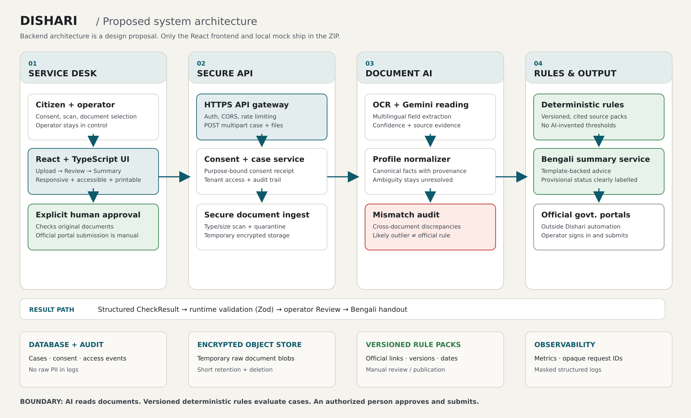
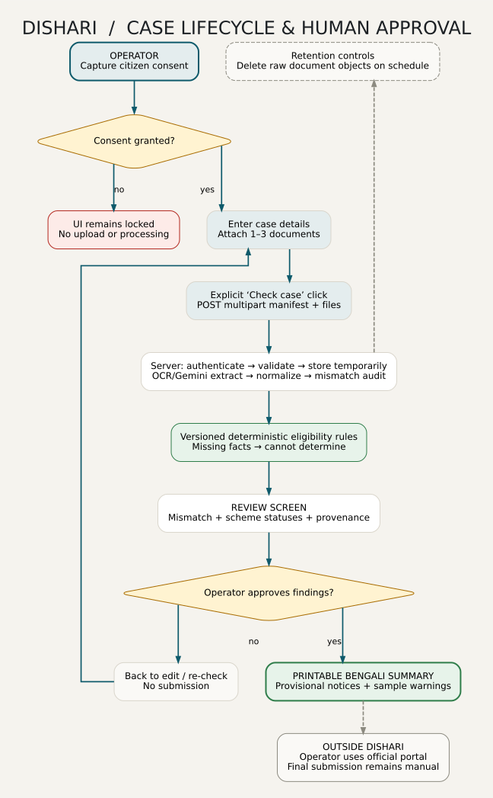
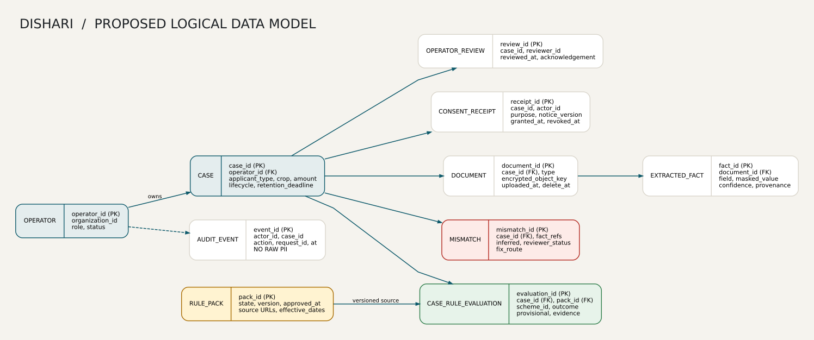

# Dishari — whole-system architecture and system design

**Design status:** proposed end-to-end system for the Dishari buildathon and production evolution. **Only the React/TypeScript frontend and a synthetic dev mock are implemented in this ZIP.** All backend nodes below are architecture, integration contracts and next-step guidance—not a claim of working services.

## 1. Goal and boundaries

An authorized CSC/service-centre operator helps a citizen (initially West Bengal) assess document readiness and potential welfare/scheme matches. Dishari reads scans, detects inconsistencies, applies deterministic scheme rules, and prepares a large Bengali handout. **Human operator approval is mandatory** and official portal submissions occur **outside** Dishari via normal authorized channels.

**Diagram sources:** the editable vector [`diagrams/architecture.svg`](diagrams/architecture.svg) (generated by `scripts/draw-architecture.py`) and companion editable [`architecture.dot`](diagrams/architecture.dot) / [`architecture.mmd`](diagrams/architecture.mmd) representations. A PNG export is available for slides.

## 2. Components

| Layer | Responsibilities | Proposed implementation | Trust / failure mode |
|---|---|---|---|
| Citizen + operator | Consent, scan, review, official application | CSC desk/camera; human-in-loop | Consent must be affirmative and logged |
| Operator frontend | Upload, stepper, cards, bilingual summary, print | React 18, TypeScript, Vite, Zod | No secrets, no official auto-submit |
| Edge/API | HTTPS, authentication, upload limits, CORS, request IDs | API gateway / load balancer; FastAPI or Node | 401/403, 413, 429, abuse controls |
| Consent and case service | Store consent receipt, case state, retention timestamp | Relational DB + API | Browser consent boolean alone is not proof |
| Document ingest | Type sniffing, malware scan, encrypted temporary storage, masking | Object store + server-side validators | Never pass raw docs to logs |
| Document extraction | OCR/multimodal reading of Bengali/Hindi/English | Text OCR first; Gemini when needed | Confidence + evidence, never authoritative rules |
| Profile normalizer | Canonical family facts and provenance | Typed validation + normalization rules | Ambiguous facts marked unresolved |
| Cross-document audit | Compare names, IDs, dates, expiry, mismatches | Deterministic comparisons + cautious similarity scoring | “Likely outlier” always **inference** |
| Rules matcher | Evaluate cited eligibility and missing documents | Versioned rule packs, audited rule engine | **No generative eligibility thresholds** |
| Summary generator | Translate approved result to citizen-facing Bengali | Versioned Bengali templates + reviewed copy | Do not hallucinate new advice |
| Persistence | Case metadata, consent logs, job status, rule versions | Postgres + encrypted object store | Separate identifiers, least privilege, TTL |
| Observability | Error codes, request IDs, queue and latency metrics | Structured non-PII logs, traces, audit logs | Access-controlled, redacted events |
| Official portals | Operator login, CAPTCHA, manual submission | Existing government websites | No unauthorized automation |

## 3. End-to-end processing flow

### Synchronous hackathon MVP

1. On the web UI, operator obtains consent, enters case details and attaches documents. Until consent, the native fieldset and actions are disabled.
2. Operator explicitly clicks **Check case**. Frontend calls `POST /api/v1/cases/check` with multipart files plus manifest.
3. Backend authenticates operator; validates purpose-bound consent and input constraints; rejects malicious or overly large files; scans for malware; saves encrypted temporary objects.
4. Extraction reads document facts (`name`, `document type`, identifiers where permitted, dates) with confidence and field provenance. Mask sensitive identifiers immediately after extraction.
5. Normalizer merges facts into a structured profile while preserving source, original text and confidence. No document is silently rewritten.
6. Audit compares cross-document fields and emits mismatch records, possible outliers and fix routes. Inference must be labelled explicitly.
7. Rule engine evaluates a **small, reviewed, versioned** set of schemes against normalized facts, returning `eligible`/`cannot_determine`/`not_eligible`, reason, missing docs, source URL, rule version and provisional flag.
8. Summary renderer produces simple Bengali lines from *checked* results; the frontend validates the `CheckResult` response with Zod and displays Review.
9. Operator manually inspects, approves in the UI, prints the Bengali sheet, and chooses whether to submit separately at the **official portal**. Approval here means **approve review**, **not submit an application**.
10. Retention service deletes raw files on the configured policy (the brief proposes within 24 hours); store a non-sensitive audit trail. Implement and test erasure paths before real-person data.

### Scaled asynchronous evolution (not implemented)

When scans take too long for one request, replace step 2 with `POST /cases/{id}/checks` returning `jobId`, then poll `GET /check-jobs/{id}` (or use SSE) with `pending/running/completed/failed` statuses. Workers process jobs from an at-least-once queue. Use idempotency keys and correlation IDs. **Do not** expose unreviewed results as final eligibility.

## 4. Logical data model

Suggested entities (avoid using raw Aadhaar as a primary key):

- `operator` — opaque ID, organization ID, assigned roles, status.
- `consent_receipt` — receipt ID, case ID, actor ID, purpose, affirmative timestamp, notice version, expiry/revocation.
- `case` — opaque ID, operator ID, applicant type, crop/activity, amount, lifecycle state, retention timestamp.
- `document` — opaque document ID, case ID, type, encrypted object key, MIME, hash, upload timestamp, deletion deadline; no raw document bytes in DB.
- `extracted_fact` — document ID, field type, masked value, confidence, source bounding region/page; minimize stored sensitive values.
- `mismatch` — fact references, type, severity, inferred flag, fix-route suggestion, reviewer status.
- `rule_pack` and `scheme_rule` — scheme ID, jurisdiction, version, effective-from/to, official URL, approval timestamp, expression, document requirements.
- `case_rule_evaluation` — case ID, rule-pack version, outcome, reasoning evidence, missing documents, provisional flag.
- `operator_review` — case ID, reviewer ID, reviewed timestamp, acknowledgement; never equal to official submission.
- `audit_event` — actor, action, request ID and timestamp, **no raw PII**.

## 5. Exact responsibility split (critical)

**Multimodal AI / Gemini** can extract text, language and document fields and provide confidence scores. It must not set income limits, scheme requirements, benefit amounts, eligibility status, or policies. It also cannot independently certify that a correction route is free.

**Deterministic rules** consume normalized facts + `rule_pack` versions. Each rule must point to an official source, have an effective date and review owner. The result includes a reason/evidence trace and, when needed, `cannot_determine` with a list of missing facts. The frontend is intentionally generic: the backend may return 1 or 30 schemes without modifying card layout.

**Human** checks original documents against extraction and mismatch suggestions. The review approval advances to citizen summary only. Government authentication, CAPTCHA, OTP and final official submission remain with authorized people.

## 6. Data security and privacy architecture

- Use HTTPS, scoped operator sessions, least-privilege IAM and per-tenant authorization.
- Obtain consent **before** uploads. Record a server-side receipt; prevent processing on revoked/expired consent.
- Client/server validate type/size; quarantine suspicious uploads; normalize image formats; enforce document count and file limits.
- Mask Aadhaar and other unique identifiers early; don't send unmasked IDs to telemetry or unnecessary external services. Apply service-provider data processing review before using a model API.
- Encrypt documents at rest and in transit; keep object store private; short-lived presigned access; protect DB backups.
- Configure retention and **test deletion** of raw objects, temporary cache, queues and processing artifacts; target 24 h from the brief, subject to legal/policy confirmation.
- Keep access logs, consent audit and policy trace without raw documents. Add deletion and abuse-rate tests.
- Establish independent review of local law, government API permissions, and accuracy before live deployment.

## 7. Failure handling

| Failure | User-visible behaviour | Service behaviour |
|---|---|---|
| Missing consent | Upload/actions disabled; polite hint | Server rejects request even if forged |
| Malformed/oversized file | Upload validation error | 415/413; don't retain file |
| OCR/Gemini uncertain | “Cannot determine”; request missing/clearer docs | Persist evidence and confidence, don't invent data |
| Rule source unavailable/outdated | No eligibility assertion | Rule pack disabled/needs review |
| Upload/API timeout | Error and retry on step 1 | Idempotent job, compensating deletion |
| API contract mismatch | Safe message; cannot progress | Schema violation recorded by request ID |
| Bengali copy unreviewed | Block real use | Require human language review before launch |
| Browser loses connection | Bundled demo still works offline | No service guarantee for real case |
| Operator disagrees with result | No auto-submission | Keep correction and override audit trail |

## 8. Production topology (suggestion)

- Static React frontend behind CDN (Vercel, S3/CloudFront, or equivalent).
- HTTPS API service under separate origin with strict CORS and auth, deployed on managed containers/serverless.
- Private Postgres database and encrypted object storage, secrets in a managed secret store.
- Worker/queue added for slow scans. Quarantine and extraction workers with narrow object permissions.
- Rules checked into a reviewed repo and published as versioned signed/hashed rule packs; scheduled official-source verification and rollback strategy.
- Metrics: extraction confidence distribution, mismatch precision, scheme outcome distribution, manual overrides, latency, API error rate, scan deletion success, operator time per case. Store metrics without PII.

### MVP vs later

| Milestone | In this ZIP | Real backend next | Scale / field pilot later |
|---|---|---|---|
| 3-step UI and offline flow | **Yes** | — | Hardened translations and field tests |
| API request+response contract | **Yes** | Implement endpoint | Async jobs, idempotency |
| Document parsing, audit, matching | **No** | Build narrow vertical | Confidence calibration |
| Official scheme rule pack | **No** | Verify 3 WB schemes across departments | Maintain 20–30 schemes |
| DigiLocker retrieval | **No** | — | Consent-based integration |
| Operator auth and consent DB | **No** | Build before real data | Multitenancy, audit |
| Official portal form submission | **Not intended** | Human only | Optional local authorized autofill later |
| Bengali translation quality assurance | **Not complete** | Native review | Regional expansion |

## 9. Architecture decisions

- **ADR-001:** Start with one synchronous POST to simplify the hackathon; isolate all network logic in `caseApi.ts` for a future job-based API.
- **ADR-002:** `CheckResult` is a versioned response with Zod validation; invalid data produces a safe error, not a broken scheme card.
- **ADR-003:** Store status as an explicit enum; color is always accompanied by icon + word. Provisional and inference are explicit metadata.
- **ADR-004:** Treat the local demo as `analysisOrigin: sample` even when reached via a mock HTTP API. Do not silently substitute fake results when the real backend fails.
- **ADR-005:** Do not implement government form submission in the frontend or demo. Human remains in control.

See [`API_CONTRACTS.md`](API_CONTRACTS.md) for the precise endpoint and [`INTEGRATION_PLAYBOOK.md`](INTEGRATION_PLAYBOOK.md) for how to connect the actual services incrementally.
